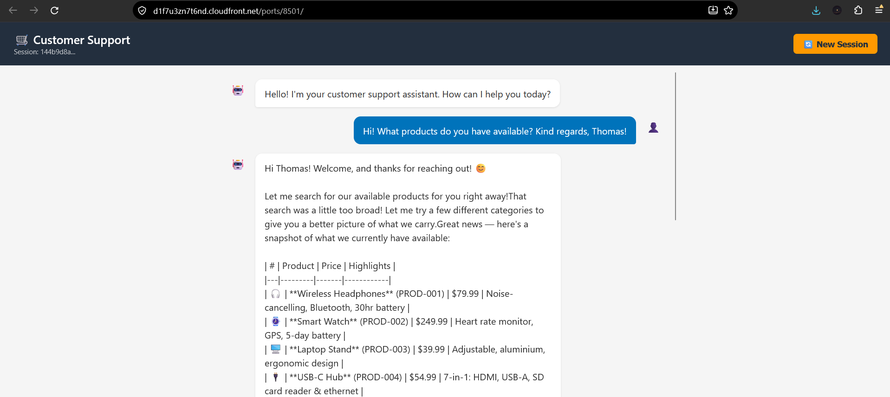
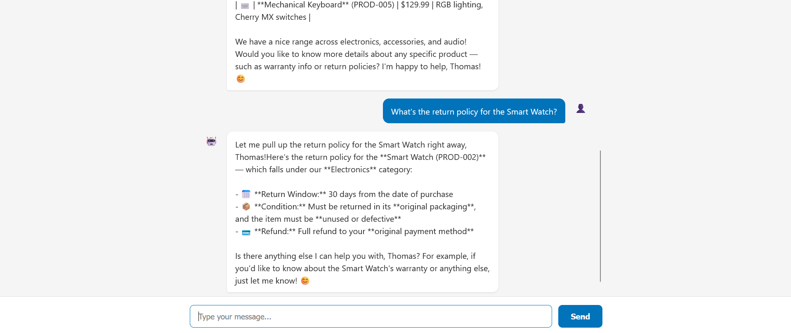
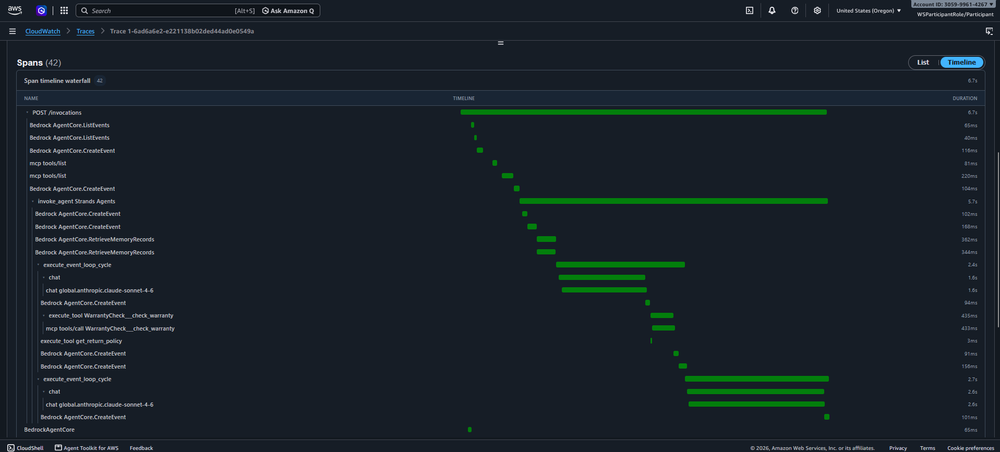
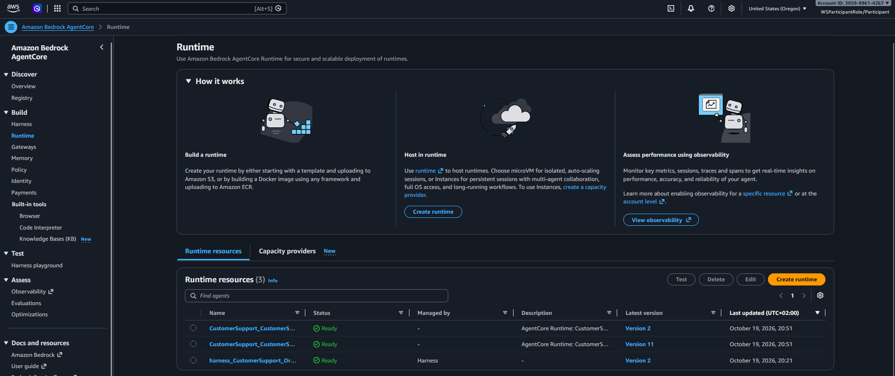
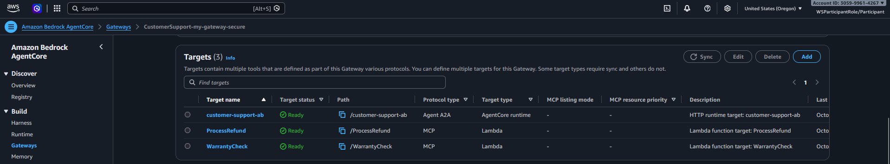
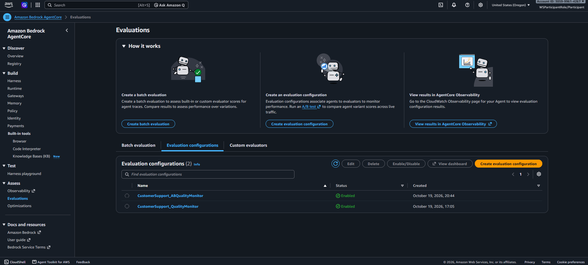
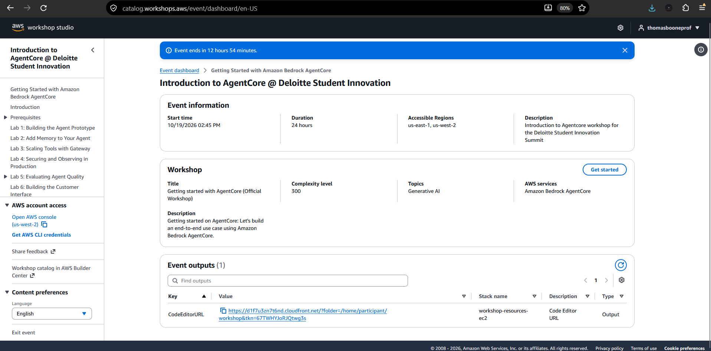
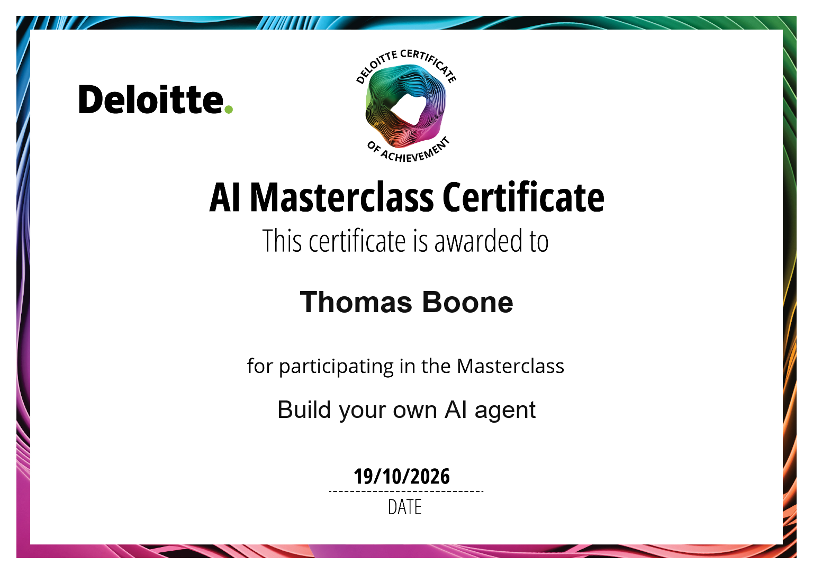

# Production-Ready AI Agent on Amazon Bedrock AgentCore

An end-to-end AI-powered customer support agent built with [Amazon Bedrock AgentCore](https://aws.amazon.com/bedrock/agentcore/) and the [Strands Agents SDK](https://github.com/strands-agents/sdk-python), deployed as a fully managed, serverless production system on AWS.

Built during the **Deloitte Student Innovation Summit 2026** in collaboration with **AWS** Solutions Architects.

---

## Overview

This project demonstrates how to take an AI agent from local prototype to production-grade system. The agent serves as an intelligent customer support assistant for a fictional e-commerce company, capable of answering product questions, processing refunds within policy limits, checking warranties, searching the web, and remembering customers across sessions.

What makes this more than a chatbot is the **production infrastructure** around it: authentication, persistent memory, centralized tool routing, fine-grained access policies, real-time observability, continuous evaluation, and automated optimization — all without managing servers.

### Key Capabilities

| Capability | Implementation |
|---|---|
| **Natural Language Understanding** | Claude Sonnet 4.6 via Amazon Bedrock (cross-region inference) |
| **Persistent Memory** | Semantic + summarization strategies across sessions |
| **Tool Routing** | Centralized AgentCore Gateway with Lambda-backed tools |
| **Authentication** | Amazon Cognito with JWT-based access control |
| **Access Governance** | Cedar policies enforcing refund limits and tool permissions |
| **Observability** | CloudWatch traces, structured logs, real-time monitoring |
| **Continuous Evaluation** | Built-in evaluators for goal success, correctness, and tool accuracy |
| **Prompt Optimization** | AI-generated recommendations from production traces |
| **A/B Testing** | Gateway-level traffic splitting between prompt variants |
| **Zero-Code Agents** | Declarative harness agents with human-in-the-loop support |
| **Web Interface** | Flask-based chat frontend with Cognito login flow |

---

## Architecture


The system consists of two agent runtimes sharing a common infrastructure layer:

- **CustomerSupport Agent** (Strands SDK) — Code-based agent with local tools, memory integration, and Gateway access
- **OrderResearch Agent** (Harness) — Zero-code declarative agent with code interpreter, Gateway tools, and human-in-the-loop approval flows
- **AgentCore Gateway** — Centralized tool routing with Cedar policy enforcement, connecting to Lambda functions (warranty check, refund processing) and web search
- **AgentCore Memory** — Persistent semantic and summarization memory shared across agents
- **Amazon Bedrock** — Claude Sonnet 4.6 foundation model via cross-region inference

---

## Screenshots

### Chat Interface
The customer-facing web interface with real-time streaming responses. The agent recognizes returning customers through persistent memory and uses tools to look up product information and return policies.





### Observability — Trace Waterfall
End-to-end distributed trace showing every span in a single agent invocation: model calls to Claude Sonnet 4.6, memory retrieval, tool execution via the Gateway (warranty check, return policy), and event logging — all with timing data.



### Deployed Runtimes
Three runtimes deployed on AgentCore: the primary CustomerSupport agent (Version 11), the A/B testing variant, and the zero-code Harness agent — all in Ready state.



### Gateway Tool Routing
The AgentCore Gateway with three targets: Lambda-backed warranty check and refund processing tools, plus an HTTP runtime target for A/B testing traffic.



### Continuous Evaluation
Two online evaluation configurations monitoring agent quality: QualityMonitor (GoalSuccessRate, Correctness, ToolSelectionAccuracy) and ABQualityMonitor for A/B testing.



---

## Project Structure

```
CustomerSupport/
├── app/
│   ├── CustomerSupport/           # Primary agent
│   │   ├── main.py                # Agent entry point (Strands + Memory + Gateway)
│   │   ├── model/load.py          # Bedrock model config (Claude Sonnet 4.6)
│   │   ├── memory/session.py      # AgentCore Memory session manager
│   │   ├── mcp_client/client.py   # MCP web search client
│   │   ├── tool/                   # Gateway tool schemas (warranty, refund)
│   │   └── frontend/              # Flask chat UI with Cognito auth
│   │       ├── frontend.py
│   │       └── templates/index.html
│   │
│   ├── CustomerSupportAB/         # A/B testing variant (config-bundle aware)
│   │   └── main.py                # Dedicated runtime with dynamic prompt hook
│   │
│   └── OrderResearchAgent/        # Zero-code harness agent
│       ├── harness.json           # Declarative agent config
│       └── test_hitl.py           # Human-in-the-loop test script
│
└── agentcore/
    ├── agentcore.json             # Full infrastructure declaration
    └── cdk/                       # Auto-generated CDK (managed by CLI)
```

---

## Technical Deep Dive

### 1. Agent Foundation

The core agent is built with the **Strands Agents SDK**, a lightweight Python framework for building tool-using agents. It uses Claude Sonnet 4.6 through Amazon Bedrock's cross-region inference for optimal throughput and resilience.

```python
agent = Agent(
    model=BedrockModel(model_id="global.anthropic.claude-sonnet-4-6"),
    session_manager=get_memory_session_manager(session_id, user_id),
    system_prompt=SYSTEM_PROMPT,
    tools=[get_return_policy, get_product_info, gateway_tools, mcp_client]
)
```

Local tools handle product catalog lookups and return policy queries. Remote tools (warranty checks, refund processing) are exposed as Lambda functions through the AgentCore Gateway, keeping sensitive operations serverless and independently scalable.

### 2. Persistent Memory

AgentCore Memory provides cross-session persistence through two strategies:

- **Semantic Memory** — Extracts and stores factual information (customer names, preferences, order history) in user-scoped namespaces, retrievable by relevance
- **Summarization Memory** — Compresses conversation history into summaries, providing continuity when a customer returns days later

Memory namespaces use variable substitution (`/users/{actorId}/facts`) to automatically isolate each customer's data.

### 3. Gateway & Tool Routing

The AgentCore Gateway centralizes all remote tool access behind a single authenticated endpoint. Tools are defined declaratively — Lambda ARNs with JSON schemas — and the gateway handles routing, authentication forwarding, and policy enforcement.

This design decouples tool implementation from the agent: new tools can be added or swapped without touching agent code.

### 4. Identity & Access Control

Authentication flows through Amazon Cognito:
- **User-facing**: Authorization code flow with PKCE for the web frontend
- **Machine-to-machine**: Client credentials grant for service-to-service communication (e.g., harness-to-gateway OAuth)

The AgentCore Runtime validates JWT tokens and extracts user identity from claims, ensuring every request is authenticated and attributable.

### 5. Cedar Policy Governance

Fine-grained access control is implemented through Cedar policies on the Gateway's policy engine:

- **Refund limits** — Permits refund processing only when `amount < 100`
- **Reason requirements** — Forbids refund processing unless the reason contains "defective"
- **Tool-level permissions** — Controls which authenticated principals can invoke which tools

Policies run in `ENFORCE` mode, meaning violations are blocked at the gateway before reaching the Lambda function.

### 6. Observability

Every agent invocation is traced end-to-end through AWS X-Ray and CloudWatch:
- Full request traces showing tool calls, model invocations, and latency breakdowns
- Structured runtime logs with configurable verbosity
- Transaction Search for querying traces across time ranges

### 7. Continuous Evaluation

Online evaluation pipelines monitor agent quality in real-time using built-in evaluators:
- **Goal Success Rate** — Did the agent achieve what the user asked?
- **Correctness** — Are the agent's responses factually accurate?
- **Tool Selection Accuracy** — Did the agent pick the right tools?

Evaluators run on a configurable sampling rate (100% during development) and feed into the optimization loop.

### 8. Prompt Optimization & A/B Testing

The optimization pipeline uses real production traces to generate AI-powered recommendations for system prompts and tool descriptions. These recommendations are deployed as **Config Bundles** — versioned, immutable configuration snapshots.

A/B testing splits gateway traffic between a control prompt and a treatment (optimized) prompt, with an online evaluator measuring the impact. The dedicated `CustomerSupportAB` runtime uses a `BeforeModelCallEvent` hook to dynamically apply the active config bundle's system prompt before each model call.

### 9. Zero-Code Harness Agent

The `OrderResearchAgent` demonstrates AgentCore Harness — a declarative approach to building agents without writing framework code. Defined entirely in `harness.json`, it includes:
- **Code Interpreter** with shell access and filesystem persistence
- **Gateway tool integration** via OAuth outbound authentication
- **Inline functions** for human-in-the-loop workflows (manager approval for exception refunds)

The HITL flow uses the `invoke_harness` API with pause/resume semantics: the agent pauses with `stopReason: "tool_use"` when it needs human input, and the caller resumes it with the decision.

---

## Tech Stack

| Layer | Technology |
|---|---|
| Foundation Model | Claude Sonnet 4.6 (Amazon Bedrock, cross-region) |
| Agent Framework | Strands Agents SDK (Python) |
| Infrastructure | Amazon Bedrock AgentCore (Runtime, Memory, Gateway, Identity) |
| Authentication | Amazon Cognito (JWT + OAuth 2.0) |
| Policy Engine | Cedar (via AgentCore Gateway) |
| Remote Tools | AWS Lambda |
| Web Search | Exa AI (MCP) / AWS-managed Web Search Connector |
| Frontend | Flask + Vanilla JS |
| IaC | AgentCore CLI + AWS CDK (auto-managed) |
| Observability | AWS X-Ray + CloudWatch |

---

## Development Workflow

The project was built iteratively, progressively layering production capabilities onto the base agent:

1. **Prototype** — Scaffolded with `agentcore create`, added domain-specific tools, tested locally with `agentcore dev`
2. **Memory** — Added semantic and summarization memory for cross-session persistence
3. **Gateway & Tools** — Centralized remote tools (warranty, refund) behind an authenticated gateway
4. **Security** — Enabled JWT authentication, Cognito integration, and custom header allowlisting
5. **Observability** — Configured traces, logs, and Transaction Search for production monitoring
6. **Evaluation** — Set up continuous online evaluation with built-in quality metrics
7. **Frontend** — Built a Flask chat interface with Cognito login and streaming responses
8. **Governance** — Implemented Cedar policies for refund limits, reason validation, and tool-level access control
9. **Harness** — Created a declarative zero-code agent with code interpreter, gateway tools, and human-in-the-loop
10. **Optimization** — Generated AI recommendations from traces, deployed as config bundles with A/B testing

Each layer builds on the previous, demonstrating how AgentCore handles the undifferentiated heavy lifting of taking agents to production.

---

## Context

This project was built at the **Deloitte Student Innovation Summit 2026**, a collaborative event exploring the intersection of generative AI and enterprise-grade cloud infrastructure. The focus was on understanding the full lifecycle of deploying AI agents to production — moving beyond prompt engineering into the systems engineering challenges of authentication, governance, observability, and continuous optimization.





---

## License

This project was built for educational and demonstration purposes during the Deloitte Student Innovation Summit 2026.
