# Workshop Guide: Getting Started with Amazon Bedrock AgentCore

> **This document contains the complete step-by-step instructions used to build this project.**
> If you want to recreate this project from scratch, follow each lab in order. The instructions are from the official **"Getting Started with Amazon Bedrock AgentCore"** workshop, originally completed at the **Deloitte Student Innovation Summit 2026** in collaboration with AWS.
>
> **Total estimated time:** ~4 hours across 10 progressive labs.

---

## Table of Contents

- [Overview](#overview)
- [What is Amazon Bedrock AgentCore?](#what-is-amazon-bedrock-agentcore)
- [What You'll Build](#what-youll-build)
- [Prerequisites & Environment Setup](#prerequisites--environment-setup)
  - [AWS Event Setup](#aws-event-setup)
  - [Self-paced Setup](#self-paced-setup)
- [Lab 1: Building the Agent Prototype](#lab-1-building-the-agent-prototype)
- [Lab 2: Add Memory to Your Agent](#lab-2-add-memory-to-your-agent)
- [Lab 3: Scale with Gateway & Identity](#lab-3-scale-with-gateway--identity)
- [Lab 4: Secure and Observe in Production](#lab-4-secure-and-observe-in-production)
- [Lab 5: Evaluate Agent Performance](#lab-5-evaluate-agent-performance)
- [Lab 6: Build Customer Interface](#lab-6-build-customer-interface)
- [Lab 7: Govern Agent Actions](#lab-7-govern-agent-actions)
- [Lab 8: Zero-Code Agents with Harness](#lab-8-zero-code-agents-with-harness)
- [Lab 9: Optimizing Agent Quality](#lab-9-optimizing-agent-quality)
- [Lab 10: Web Search with AgentCore Gateway](#lab-10-web-search-with-agentcore-gateway)

---

## Overview

You've built an agent that works on your laptop. Now what?

Getting it to production means building authentication, memory, tool routing, observability, and governance. None of that is your agent's core logic, but all of it stands between you and real users.

This workshop walks you through each of those layers in about 4 hours.

Using Amazon Bedrock AgentCore, you'll build a customer support agent from scratch, deploy it to a serverless runtime, and progressively layer on production capabilities (memory, tools, auth, observability, evaluations, governance, and optimization) without managing infrastructure directly.

### This Workshop in Context

This workshop is part of a two-phase learning journey for AgentCore:

| Phase | Workshop | What you get |
|---|---|---|
| 1. Foundations (this guide) | Getting Started with AgentCore | A fully prescribed, end-to-end build — CLI-driven, progressive labs from prototype to production |
| 2. Deep Dive | Diving Deep into AgentCore | Choose-your-own adventure powered by AgentCore CLI and Claude Code |

---

## What is Amazon Bedrock AgentCore?

Amazon Bedrock AgentCore is the infrastructure layer purpose-built for taking agents from prototype to production. It handles the undifferentiated heavy lifting (serverless execution, session isolation, memory management, tool routing, identity, observability, and policy enforcement) so you can focus on what your agent actually does.

AgentCore works with any agent framework (Strands, LangGraph, CrewAI, and others) and any foundation model (Claude, Nova, Llama, Mistral, GPT, Gemini). You're not locked into a specific stack.

### Interfaces

| Interface | What it's for |
|---|---|
| **AgentCore CLI** | Scaffold, configure, deploy, and manage agents from your terminal. The fastest path from zero to deployed. |
| **AgentCore Python SDK** | Python modules for runtime, memory, tools, identity, and evaluations. Use alongside the CLI or standalone. |
| **AgentCore MCP Server** | Conversational agent development from MCP-compatible editors (Kiro, Cursor, Claude Code, Amazon Q CLI). |
| **AWS SDK (boto3, etc.)** | Full API coverage for operations the CLI and Python SDK don't yet support, or for non-Python languages. |
| **AWS Console** | Visual management of AgentCore services, code snippets, and the agent sandbox for testing. |
| **AWS CLI** | Scripted control-plane and data-plane operations, useful for CI/CD and testing. |

This workshop uses the **AgentCore CLI** with **Strands Agents** and **Claude Sonnet 4.6** on Amazon Bedrock.

---

## What You'll Build

A customer support agent for a fictional e-commerce company, progressively enhanced across 10 labs:

| Lab | Title | Time | What You'll Build |
|---|---|---|---|
| 1 | Create Agent Prototype | ~20 min | Scaffold a project, add custom tools, test locally, deploy to AWS |
| 2 | Add Memory | ~20 min | Persistent memory across sessions with SEMANTIC and SUMMARIZATION strategies |
| 3 | Scale with Gateway & Identity | ~30 min | Centralize tools via Lambda + AgentCore Gateway |
| 4 | Secure and Observe in Production | ~15 min | JWT authentication, session management, traces, and logs |
| 5 | Evaluate Agent Performance | ~15 min | Continuous quality monitoring with built-in evaluators |
| 6 | Build Customer Interface | ~20 min | Flask chat frontend with Cognito login |
| 7 | Govern Agent Actions | ~20 min | Fine-grained Cedar policies to control tool access at the Gateway |
| 8 | Zero-Code Agents with Harness | ~25 min | Declarative agents, shell access, inline functions for human-in-the-loop |
| 9 | Optimizing Agent Quality | ~30 min | AI-generated recommendations and Gateway-based A/B testing |
| 10 | Web Search with AgentCore Gateway | ~30 min | AWS-managed web search connector on the secured Gateway (us-east-1 only) |

The agent will:
- Answer questions about products and return policies (local tools)
- Check warranty status via a Lambda function exposed through the Gateway (remote tool)
- Remember customer names, preferences, and history across sessions (memory)
- Search the web for troubleshooting help (Exa AI via MCP, replaced in Lab 10 by AWS-managed Web Search)
- Authenticate users via Cognito (identity)
- Process refunds within policy limits (governance)
- Get continuously evaluated and improved (evaluations + optimization)

---

## Prerequisites & Environment Setup

### AWS Event Setup

During an AWS-hosted event, everything is pre-configured: a temporary account, a browser-based Code Editor with all tools installed, and credentials already wired up.

1. **Sign In to Workshop Studio** — Follow the link provided by your instructor (or enter the 12-digit access code)
2. **Open the Code Editor** — In Workshop Studio left-hand navigation, open Event Outputs and find CodeEditorURL
3. **Open the Terminal** — Press `Ctrl+`` (backtick), or go to View → Terminal
4. **Verify Your Environment:**

```bash
aws sts get-caller-identity
agentcore --version    # Should show 0.30.0
node --version         # Should show v22
uv --version
```

### Self-paced Setup

You'll need your local tools installed, an AWS account configured, and a CloudFormation prerequisites stack.

#### Part 1: Install Local Tools

| Tool | Why | Minimum version | Check |
|---|---|---|---|
| Node.js | Runs the AgentCore CLI | 22.x | `node --version` |
| uv | Manages Python environments and dependencies | 0.4+ | `uv --version` |
| AWS CLI | Authenticates to AWS | 2.x | `aws --version` |
| Git | Version control | 2.x | `git --version` |

```bash
# Node.js (using nvm)
nvm install 22
nvm use 22

# uv
curl -LsSf https://astral.sh/uv/install.sh | sh

# AgentCore CLI
npm install -g @aws/agentcore@0.30.0
```

#### Part 2: Configure AWS Access

Supported regions: `us-east-1` (N. Virginia) and `us-west-2` (Oregon). Pick one and use it consistently.

```bash
aws configure
# Or export directly:
export AWS_ACCESS_KEY_ID=<your-access-key>
export AWS_SECRET_ACCESS_KEY=<your-secret-key>
export AWS_DEFAULT_REGION=<your-chosen-region>
```

#### Part 3: Deploy the Prerequisites Stack

Deploy the CloudFormation stack that creates shared resources (Cognito user pool, Lambda function, SSM parameters):

Use the appropriate Launch Stack button for your region from the workshop page.

Verify:

```bash
aws cloudformation describe-stacks \
  --stack-name agentcore-workshop-prereqs \
  --query 'Stacks[0].StackStatus' --output text
```

#### Part 4: Enable Transaction Search (for Observability)

```bash
aws xray update-indexing-rule \
  --name Default \
  --rule '{"Probabilistic": {"DesiredSamplingPercentage": 100}}'
```

---

## Lab 1: Building the Agent Prototype

**⏱️ Estimated time: ~20 minutes**

Build a customer support agent that answers questions about products, looks up return policies, and searches the web. Scaffold with the AgentCore CLI, add custom tools, test locally, and deploy to the cloud.

### Step 1: Create the Project

```bash
agentcore create \
  --name CustomerSupport \
  --framework Strands \
  --model-provider Bedrock \
  --memory none
```

Then change into the project directory:

```bash
cd CustomerSupport
```

### Step 2: Project Structure

```
CustomerSupport/
├── AGENTS.md
├── agentcore/
│   ├── agentcore.json         # Main project config
│   ├── aws-targets.json       # Deployment targets
│   ├── .env.local             # API keys (gitignored)
│   ├── .llm-context/          # TypeScript type definitions
│   └── cdk/                   # CDK infrastructure
└── app/
    └── CustomerSupport/
        ├── main.py            # Agent entry point
        ├── model/load.py      # Model configuration
        ├── mcp_client/client.py  # MCP client (Exa AI web search)
        └── pyproject.toml     # Python dependencies
```

### Step 3: Customize the Agent with Customer Support Tools

Replace the entire contents of `app/CustomerSupport/main.py` with:

```python
from strands import Agent, tool
from bedrock_agentcore.runtime import BedrockAgentCoreApp
from model.load import load_model
from mcp_client.client import get_streamable_http_mcp_client

app = BedrockAgentCoreApp()
log = app.logger

# Exa AI MCP client for web search
mcp_clients = [get_streamable_http_mcp_client()]

# --- Customer Support Tools ---

RETURN_POLICIES = {
    "electronics": {"window": "30 days", "condition": "Original packaging required, must be unused or defective", "refund": "Full refund to original payment method"},
    "accessories": {"window": "14 days", "condition": "Must be in original packaging, unused", "refund": "Store credit or exchange"},
    "audio": {"window": "30 days", "condition": "Defective items only after 15 days", "refund": "Full refund within 15 days, replacement after"},
}

PRODUCTS = {
    "PROD-001": {"name": "Wireless Headphones", "price": 79.99, "category": "audio", "description": "Noise-cancelling Bluetooth headphones with 30h battery life", "warranty_months": 12},
    "PROD-002": {"name": "Smart Watch", "price": 249.99, "category": "electronics", "description": "Fitness tracker with heart rate monitor, GPS, and 5-day battery", "warranty_months": 24},
    "PROD-003": {"name": "Laptop Stand", "price": 39.99, "category": "accessories", "description": "Adjustable aluminum laptop stand for ergonomic desk setup", "warranty_months": 6},
    "PROD-004": {"name": "USB-C Hub", "price": 54.99, "category": "accessories", "description": "7-in-1 USB-C hub with HDMI, USB-A, SD card reader, and ethernet", "warranty_months": 12},
    "PROD-005": {"name": "Mechanical Keyboard", "price": 129.99, "category": "electronics", "description": "RGB mechanical keyboard with Cherry MX switches", "warranty_months": 24},
}

@tool
def get_return_policy(product_category: str) -> str:
    """Get return policy information for a specific product category.

    Args:
        product_category: Product category (e.g., 'electronics', 'accessories', 'audio')

    Returns:
        Formatted return policy details including timeframes and conditions
    """
    category = product_category.lower()
    if category in RETURN_POLICIES:
        policy = RETURN_POLICIES[category]
        return f"Return policy for {category}: Window: {policy['window']}, Condition: {policy['condition']}, Refund: {policy['refund']}"
    return f"No specific return policy found for '{product_category}'. Please contact support for details."

@tool
def get_product_info(query: str) -> str:
    """Search for product information by name, ID, or keyword.

    Args:
        query: Product name, ID (e.g., 'PROD-001'), or search keyword

    Returns:
        Product details including name, price, category, and description
    """
    query_lower = query.lower()
    if query.upper() in PRODUCTS:
        p = PRODUCTS[query.upper()]
        return f"{p['name']} ({query.upper()}): ${p['price']}, Category: {p['category']}, {p['description']}, Warranty: {p['warranty_months']} months"
    results = [f"{pid}: {p['name']} - ${p['price']} - {p['description']}" for pid, p in PRODUCTS.items()
               if query_lower in p['name'].lower() or query_lower in p['description'].lower() or query_lower in p['category'].lower()]
    if results:
        return "Found products:\n" + "\n".join(results)
    return f"No products found matching '{query}'."

tools = [get_return_policy, get_product_info]

for mcp_client in mcp_clients:
    if mcp_client:
        tools.append(mcp_client)

# --- Agent Setup ---

_agent = None

def get_or_create_agent():
    global _agent
    if _agent is None:
        _agent = Agent(
            model=load_model(),
            system_prompt="""You are a helpful and professional customer support assistant for an e-commerce company.
Your role is to:
- Provide accurate information using the tools available to you
- Be friendly, patient, and understanding with customers
- Always offer additional help after answering questions
- If you can't help with something, direct customers to the appropriate contact

You have access to tools for looking up return policies, searching product information, and more.
Additional tools may be available at runtime — always check your full tool list and use the most appropriate tool for each customer request.
Always use tools to get accurate, up-to-date information rather than guessing.""",
            tools=tools
        )
    return _agent


@app.entrypoint
async def invoke(payload, context):
    log.info("Invoking Agent.....")
    agent = get_or_create_agent()
    stream = agent.stream_async(payload.get("prompt"))
    async for event in stream:
        if "data" in event and isinstance(event["data"], str):
            yield event["data"]


if __name__ == "__main__":
    app.run()
```

**Pin the model** — Replace `app/CustomerSupport/model/load.py`:

```python
from strands.models.bedrock import BedrockModel


def load_model() -> BedrockModel:
    """Get Bedrock model client using IAM credentials."""
    return BedrockModel(model_id="global.anthropic.claude-sonnet-4-6")
```

> **Why `global.anthropic.claude-sonnet-4-6`?** The `global.` prefix is a cross-region inference profile that lets Bedrock route your request to whichever region has capacity, improving throughput and resilience.

Verify:

```bash
python3 -c "import ast; ast.parse(open('app/CustomerSupport/main.py').read()); print('OK: parses')"
grep -c 'def get_return_policy\|def get_product_info\|def invoke\|def get_or_create_agent' app/CustomerSupport/main.py
grep -c 'add_numbers' app/CustomerSupport/main.py
```

At this point, your local architecture looks like this — an agent with two custom tools and an MCP-connected web search, all running on your machine:

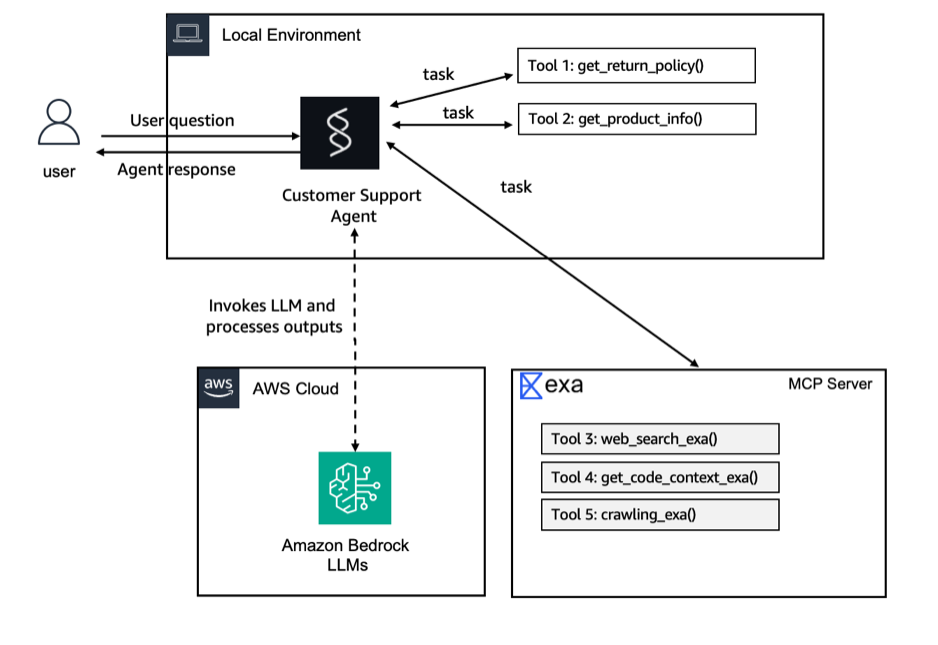

### Step 4: Start the Local Dev Server

```bash
agentcore dev --no-browser
```

### Step 5: Test Your Agent

Test queries:
- `What's the return policy for electronics?`
- `Tell me about the Wireless Headphones`
- `Search for common Bluetooth headphone troubleshooting tips`
- `I bought a Smart Watch (PROD-002) and want to return it. What's the return policy?`

Exit: press `Ctrl+C` or `Esc`.

### Step 6: Deploy to AWS

```bash
agentcore deploy
```

Check status:

```bash
agentcore status
```

Once READY, invoke from the cloud:

```bash
agentcore invoke "What can you do?"
```

The architecture has shifted — your agent is now deployed to AgentCore Runtime in the cloud:

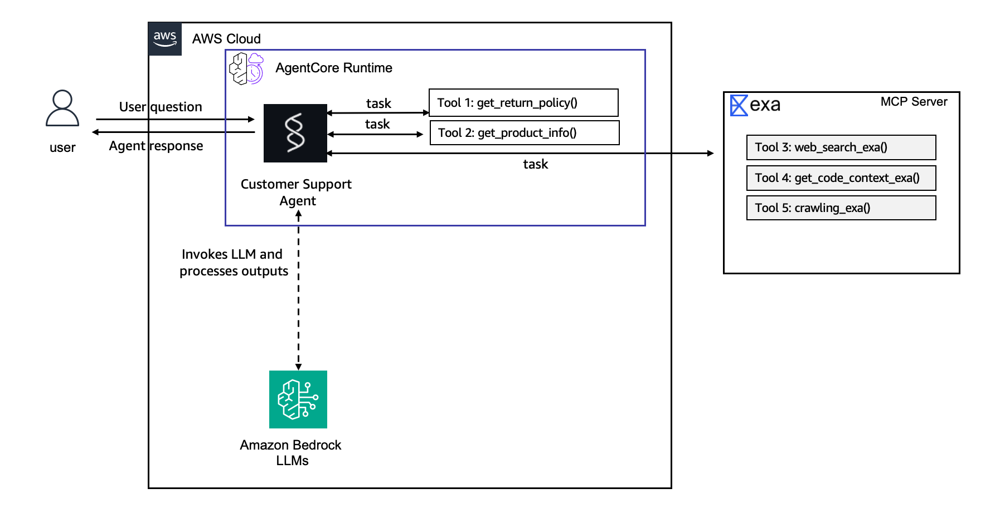

---

## Lab 2: Add Memory to Your Agent

**⏱️ Estimated time: ~20 minutes**

Add AgentCore Memory so the agent retains facts across sessions. Uses two built-in strategies:

| Strategy | Purpose | What It Does |
|---|---|---|
| SEMANTIC | Facts and context | Captures factual information (names, preferences, order details) retrievable across sessions |
| SUMMARIZATION | Conversation history | Compressed conversation summaries that provide continuity across sessions |

### Step 1: Add Memory to Your Project

```bash
agentcore add memory \
  --name SharedMemory \
  --strategies SEMANTIC,SUMMARIZATION \
  --expiry 30
```

### Step 2: Integrate Memory into Agent Code

Create the memory session manager:

```bash
mkdir -p app/CustomerSupport/memory
touch app/CustomerSupport/memory/__init__.py
touch app/CustomerSupport/memory/session.py
```

`app/CustomerSupport/memory/session.py`:

```python
import os
from typing import Optional
from bedrock_agentcore.memory.integrations.strands.config import AgentCoreMemoryConfig, RetrievalConfig
from bedrock_agentcore.memory.integrations.strands.session_manager import AgentCoreMemorySessionManager

MEMORY_ID = os.getenv("MEMORY_SHAREDMEMORY_ID")
REGION = os.getenv("AWS_REGION")

def get_memory_session_manager(session_id: str, actor_id: str) -> Optional[AgentCoreMemorySessionManager]:
    if not MEMORY_ID:
        return None

    retrieval_config = {
        f"/users/{actor_id}/facts": RetrievalConfig(top_k=3, relevance_score=0.3),
        f"/summaries/{actor_id}/{session_id}": RetrievalConfig(top_k=3, relevance_score=0.3)
    }

    return AgentCoreMemorySessionManager(
        AgentCoreMemoryConfig(
            memory_id=MEMORY_ID,
            session_id=session_id,
            actor_id=actor_id,
            retrieval_config=retrieval_config,
        ),
        REGION
    )
```

### Step 3: Update main.py to Use Memory

Key changes from Lab 1:
- Import the memory session manager
- Use a factory pattern to create agents per session/user
- Extract `session_id` and `user_id` from the runtime context

Replace `app/CustomerSupport/main.py` with the updated version that includes:
- `from memory.session import get_memory_session_manager`
- `get_or_create_agent(session_id, user_id)` accepting session/user params
- `session_manager=get_memory_session_manager(session_id, user_id)` in Agent constructor
- `context.session_id` and custom header extraction in `invoke()`

Also add the custom header allowlist to `agentcore.json` runtime config:

```json
"requestHeaderAllowlist": [
    "X-Amzn-Bedrock-AgentCore-Runtime-Custom-User-Id"
]
```

Updated architecture with AgentCore Memory integrated:

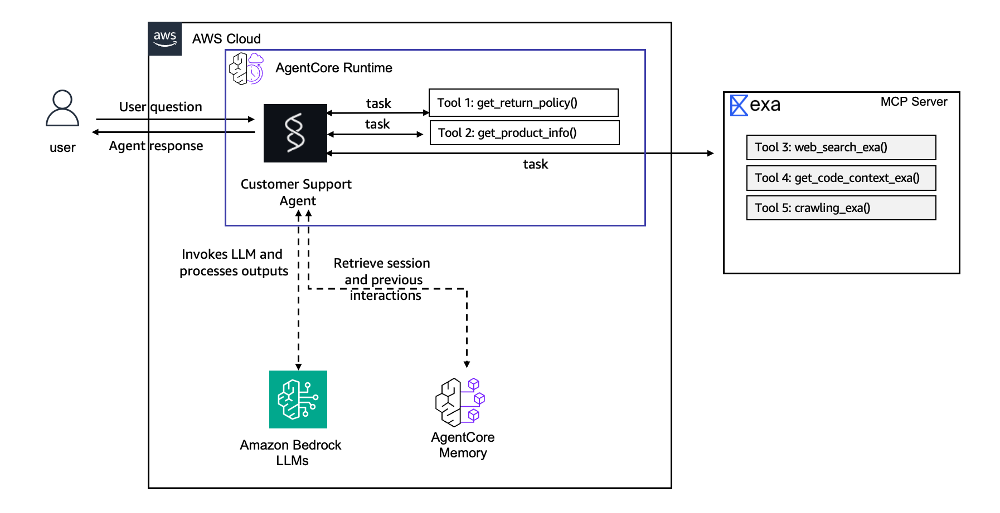

### Step 4: Deploy

```bash
agentcore deploy -y -v
```

### Step 5: Test Memory

```bash
# Session 1: Teach the agent about you
SESSION1=$(uuidgen)
agentcore invoke "Hi! My name is Sarah and I love audio products." \
  --session-id $SESSION1 \
  -H "X-Amzn-Bedrock-AgentCore-Runtime-Custom-User-Id: Sarah"

# Session 2: New session — test recall
SESSION2=$(uuidgen)
agentcore invoke "Do you remember my name?" \
  --session-id $SESSION2 \
  -H "X-Amzn-Bedrock-AgentCore-Runtime-Custom-User-Id: Sarah"
```

---

## Lab 3: Scale with Gateway & Identity

**⏱️ Estimated time: ~30 minutes**

Centralize remote tools behind the AgentCore Gateway. Instead of calling Lambda functions directly from agent code, you define them as Gateway targets with JSON schemas — the gateway handles routing, auth forwarding, and policy enforcement.

### Step 1: Create Tool Schemas

Create `app/CustomerSupport/tool/warranty_schema.json`:

```json
[
  {
    "name": "check_warranty",
    "description": "Check the warranty status of a product by its product ID (e.g. PROD-001). Returns warranty duration, status (active/expired), and expiration date.",
    "inputSchema": {
      "type": "object",
      "properties": {
        "product_id": {
          "type": "string",
          "description": "The product ID to check warranty for (e.g. PROD-001)"
        }
      },
      "required": ["product_id"]
    }
  }
]
```

Create `app/CustomerSupport/tool/refund_schema.json`:

```json
[
  {
    "name": "process_refund",
    "description": "Process a customer refund for a given order. Requires the order ID, refund amount in dollars, and a reason for the refund.",
    "inputSchema": {
      "type": "object",
      "properties": {
        "order_id": {
          "type": "string",
          "description": "The order ID to refund (e.g., ORD-12345)"
        },
        "amount": {
          "type": "integer",
          "description": "Refund amount in whole dollars"
        },
        "reason": {
          "type": "string",
          "description": "Reason for the refund (e.g., defective item, wrong product, customer dissatisfied)"
        }
      },
      "required": ["order_id", "amount", "reason"]
    }
  }
]
```

### Step 2: Add the Gateway

```bash
agentcore add gateway \
  --name my-gateway-secure \
  --enable-semantic-search
```

### Step 3: Add Gateway Targets

Add the Lambda functions as gateway targets. The Lambda ARN for the warranty check function comes from the prerequisites stack:

```bash
# Get the warranty Lambda ARN from SSM
LAMBDA_ARN=$(aws ssm get-parameter --name /app/customersupport/agentcore/warranty_lambda_arn --query 'Parameter.Value' --output text)

agentcore add gateway-target \
  --gateway my-gateway-secure \
  --name WarrantyCheck \
  --type lambdaFunctionArn \
  --lambda-arn $LAMBDA_ARN \
  --tool-schema app/CustomerSupport/tool/warranty_schema.json

agentcore add gateway-target \
  --gateway my-gateway-secure \
  --name ProcessRefund \
  --type lambdaFunctionArn \
  --lambda-arn arn:aws:lambda:$AWS_DEFAULT_REGION:$(aws sts get-caller-identity --query Account --output text):function:workshop-process-refund \
  --tool-schema app/CustomerSupport/tool/refund_schema.json
```

### Step 4: Update MCP Client for Gateway

Update `app/CustomerSupport/mcp_client/client.py` to add a gateway MCP client:

```python
import os
import logging
from mcp.client.streamable_http import streamablehttp_client
from strands.tools.mcp.mcp_client import MCPClient

logger = logging.getLogger(__name__)

EXAMPLE_MCP_ENDPOINT = "https://mcp.exa.ai/mcp"


def get_streamable_http_mcp_client() -> MCPClient:
    """Returns an MCP Client for Exa AI web search"""
    return MCPClient(lambda: streamablehttp_client(EXAMPLE_MCP_ENDPOINT))


def get_gateway_mcp_client(auth_header: str) -> MCPClient | None:
    """Returns an MCP Client for AgentCore Gateway, if configured"""
    url = os.environ.get("AGENTCORE_GATEWAY_MY_GATEWAY_SECURE_URL")
    if not url:
        logger.warning("Gateway URL not set — gateway tools unavailable")
        return None
    return MCPClient(lambda: streamablehttp_client(
        url=url,
        headers={"Authorization": auth_header}
    ))
```

### Step 5: Update main.py

Update main.py to import and use the gateway MCP client alongside the existing tools. The gateway MCP client forwards the authorization header.

### Step 6: Deploy and Test

```bash
agentcore deploy -y -v
agentcore invoke "Check the warranty for PROD-002"
```

Architecture with Gateway and Lambda-backed tools:

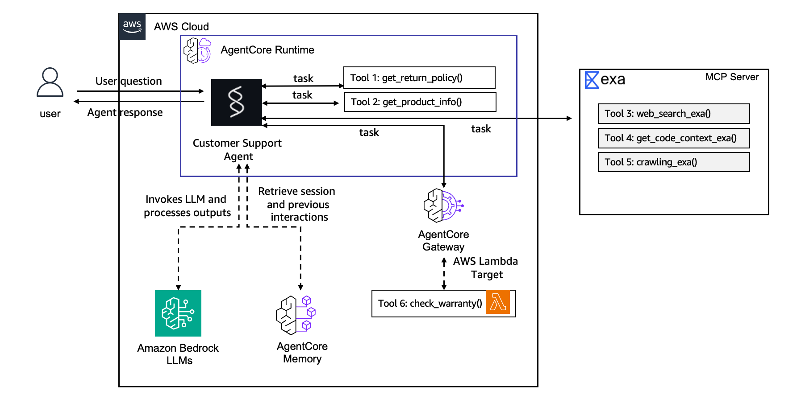

---

## Lab 4: Secure and Observe in Production

**⏱️ Estimated time: ~15 minutes**

Add JWT authentication via Amazon Cognito and enable CloudWatch-based observability.

### Step 1: Enable JWT Authentication

Add Cognito CUSTOM_JWT authorizer to the runtime in `agentcore.json`:

```json
{
  "authorizerType": "CUSTOM_JWT",
  "authorizerConfiguration": {
    "customJwtAuthorizer": {
      "discoveryUrl": "https://cognito-idp.<region>.amazonaws.com/<pool-id>/.well-known/openid-configuration",
      "allowedClients": ["<web-client-id>", "<machine-client-id>"]
    }
  }
}
```

Get the values from SSM:

```bash
POOL_ID=$(aws ssm get-parameter --name /app/customersupport/agentcore/pool_id --query 'Parameter.Value' --output text)
WEB_CLIENT=$(aws ssm get-parameter --name /app/customersupport/agentcore/web_client_id --query 'Parameter.Value' --output text)
MACHINE_CLIENT=$(aws ssm get-parameter --name /app/customersupport/agentcore/machine_client_id --query 'Parameter.Value' --output text)
```

Also add the same authorizer configuration to the Gateway.

### Step 2: Add Authorization Header

Add `"Authorization"` to the `requestHeaderAllowlist` array in the runtime config.

### Step 3: Update Agent Code for JWT-based User ID

Update `main.py` to extract the user ID from the JWT token claims instead of the custom header:

```python
import jwt

def extract_user_id(auth_header) -> str | None:
    """Resolve the Memory actor_id from the JWT bearer token."""
    if auth_header and auth_header.startswith("Bearer "):
        try:
            token = auth_header.split(" ", 1)[1]
            claims = jwt.decode(token, options={"verify_signature": False})
            user_id = claims.get("sub") or claims.get("email")
            if user_id:
                return user_id
        except Exception as e:
            log.warning(f"Failed to decode JWT for user_id: {e}")
    else:
        raise Exception("No authorization header")
```

### Step 4: Enable Telemetry

Add OTLP exporter to main.py:

```python
from strands.telemetry.config import StrandsTelemetry
StrandsTelemetry().setup_otlp_exporter()
```

### Step 5: Deploy and Test

```bash
agentcore deploy -y -v

# Get a Cognito token for invocation
TOKEN=$(aws cognito-idp initiate-auth \
  --auth-flow USER_PASSWORD_AUTH \
  --client-id $MACHINE_CLIENT \
  --auth-parameters USERNAME=workshopuser@example.com,PASSWORD=WorkshopPass1! \
  --query 'AuthenticationResult.AccessToken' --output text)

agentcore invoke "What can you do?" \
  -H "Authorization: Bearer $TOKEN" \
  --session-id $(uuidgen)
```

### Step 6: View Traces and Logs

```bash
# View recent traces
agentcore traces list

# Stream live logs
agentcore logs
```

Architecture with JWT authentication and observability:

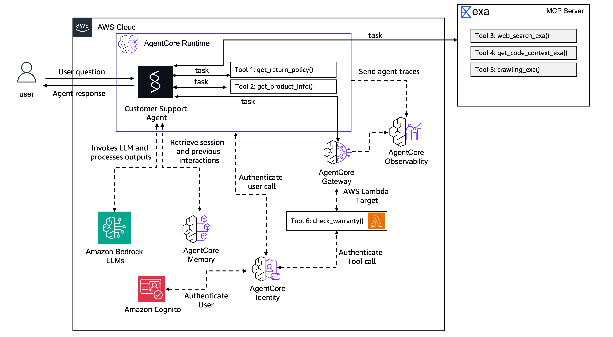

---

## Lab 5: Evaluate Agent Performance

**⏱️ Estimated time: ~15 minutes**

Set up continuous quality monitoring with built-in evaluators.

### Step 1: Add Online Evaluation

```bash
agentcore add online-eval \
  --name QualityMonitor \
  --agent CustomerSupport \
  --evaluator Builtin.GoalSuccessRate \
  --evaluator Builtin.Correctness \
  --evaluator Builtin.ToolSelectionAccuracy \
  --sampling-rate 100
```

This creates an online evaluation pipeline that samples 100% of agent invocations and runs three built-in evaluators:
- **GoalSuccessRate** — Did the agent achieve what the user asked?
- **Correctness** — Are the agent's responses factually accurate?
- **ToolSelectionAccuracy** — Did the agent pick the right tools?

### Step 2: Deploy

```bash
agentcore deploy -y -v
```

### Step 3: Generate Test Traffic

Send several test invocations to generate evaluation data:

```bash
agentcore invoke "What's the return policy for electronics?" -H "Authorization: Bearer $TOKEN" --session-id $(uuidgen)
agentcore invoke "Tell me about product PROD-003" -H "Authorization: Bearer $TOKEN" --session-id $(uuidgen)
agentcore invoke "Check warranty for PROD-001" -H "Authorization: Bearer $TOKEN" --session-id $(uuidgen)
```

### Step 4: View Evaluation Results

```bash
agentcore logs evals
```

You can also view evaluation results in the AWS Console under Amazon Bedrock AgentCore → Online Evaluations.

Architecture with continuous evaluation pipeline:

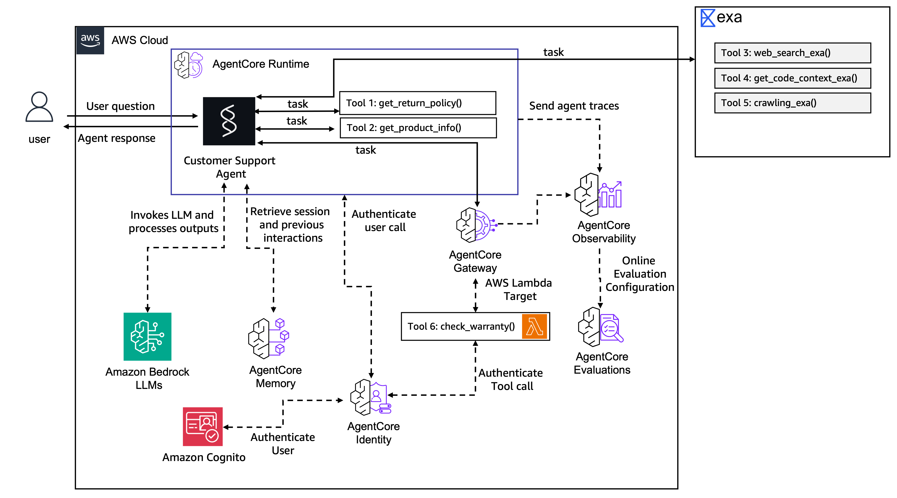

---

## Lab 6: Build Customer Interface

**⏱️ Estimated time: ~20 minutes**

Build a Flask-based chat frontend with Cognito authentication and streaming SSE responses.

### Step 1: Create Frontend Directory

```bash
mkdir -p app/CustomerSupport/frontend/templates
touch app/CustomerSupport/frontend/__init__.py
touch app/CustomerSupport/frontend/frontend.py
touch app/CustomerSupport/frontend/templates/index.html
```

### Step 2: Create frontend.py

`app/CustomerSupport/frontend/frontend.py`:

```python
"""Flask frontend for the CustomerSupport AgentCore agent.

Authenticates against Cognito on startup (USER_PASSWORD_AUTH) and serves
a chat page where the browser talks directly to the AgentCore REST API.
"""

import json
import os
import uuid

import boto3
import requests
from flask import Flask, render_template, Response

REGION = os.environ.get("AWS_REGION", os.environ.get("AWS_DEFAULT_REGION", "us-west-2"))

app = Flask(__name__)

@app.after_request
def add_no_cache_headers(response):
    response.headers["Cache-Control"] = "no-cache, no-store, must-revalidate"
    response.headers["Pragma"] = "no-cache"
    response.headers["Expires"] = "0"
    return response


def get_ssm_parameter(name: str) -> str:
    ssm = boto3.client("ssm", region_name=REGION)
    return ssm.get_parameter(Name=name)["Parameter"]["Value"]


def authenticate() -> str:
    """Authenticate against Cognito and return an access token."""
    pool_id = get_ssm_parameter("/app/customersupport/agentcore/pool_id")
    web_client_id = get_ssm_parameter("/app/customersupport/agentcore/web_client_id")
    region = pool_id.split("_")[0]

    client = boto3.client("cognito-idp", region_name=region)
    resp = client.initiate_auth(
        AuthFlow="USER_PASSWORD_AUTH",
        ClientId=web_client_id,
        AuthParameters={
            "USERNAME": "workshopuser@example.com",
            "PASSWORD": "WorkshopPass1!",
        },
    )
    return resp["AuthenticationResult"]["AccessToken"]


def get_runtime_arn() -> str:
    """Resolve the CustomerSupport runtime ARN from CloudFormation outputs."""
    cf = boto3.client("cloudformation", region_name=REGION)
    stack_name = "AgentCore-CustomerSupport-default"
    resp = cf.describe_stacks(StackName=stack_name)
    outputs = resp["Stacks"][0]["Outputs"]
    for o in outputs:
        if "RuntimeArn" in o["OutputKey"] and "CustomerSupport" in o["OutputKey"]:
            return o["OutputValue"]
    raise RuntimeError("Could not find CustomerSupport runtime ARN in stack outputs")


print("Authenticating against Cognito...")
ACCESS_TOKEN = authenticate()
print(f"Authenticated as workshopuser@example.com")

RUNTIME_ARN = get_runtime_arn()
print(f"Runtime ARN: {RUNTIME_ARN}")

REGION = RUNTIME_ARN.split(":")[3]
INVOKE_URL = (
    f"https://bedrock-agentcore.{REGION}.amazonaws.com"
    f"/runtimes/{requests.utils.quote(RUNTIME_ARN, safe='')}/invocations"
)


@app.route("/")
def index():
    return render_template(
        "index.html",
        access_token=ACCESS_TOKEN,
        runtime_arn=RUNTIME_ARN,
        invoke_url=INVOKE_URL,
        session_id=str(uuid.uuid4()),
    )


@app.route("/new-token")
def new_token():
    """Refresh the Cognito token (called when the token expires)."""
    global ACCESS_TOKEN
    ACCESS_TOKEN = authenticate()
    return {"token": ACCESS_TOKEN}


if __name__ == "__main__":
    app.run(host="127.0.0.1", port=8501, debug=False)
```

### Step 3: Create the Chat UI

Create `app/CustomerSupport/frontend/templates/index.html` with a chat interface that:
- Displays an AWS-themed header with session info
- Shows a chat container with message bubbles
- Includes quick-action buttons (Products, Return Policy, Check Warranty, Memory Test)
- Streams responses from the AgentCore REST API using SSE
- Handles typing indicators, session management, and token refresh

The frontend calls the AgentCore invoke URL directly from the browser with the JWT token in the Authorization header and the session ID in a custom header.

### Step 4: Run the Frontend

```bash
cd app/CustomerSupport/frontend
AWS_REGION=us-west-2 uv run python frontend.py
```

Access at `http://localhost:8501`.

The chat interface in action:

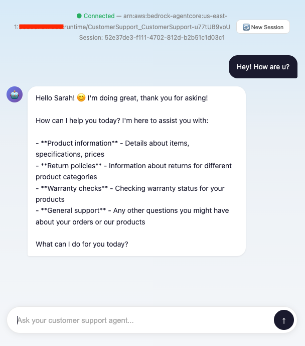

Architecture with the customer-facing frontend:

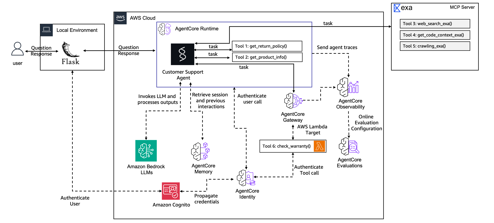

---

## Lab 7: Govern Agent Actions

**⏱️ Estimated time: ~20 minutes**

Implement fine-grained Cedar policies to control what the agent can do at the Gateway level.

### Step 1: Add a Policy Engine

```bash
agentcore add policy-engine \
  --gateway my-gateway-secure \
  --name CustomerSupportPolicyEngine \
  --mode ENFORCE
```

### Step 2: Add Refund Limit Policy

```bash
agentcore add policy \
  --policy-engine CustomerSupportPolicyEngine \
  --name refund_limit_policy \
  --description "Allow refunds under 100 dollars only" \
  --statement 'permit(principal, action == AgentCore::Action::"ProcessRefund___process_refund", resource == AgentCore::Gateway::"<gateway-arn>") when { context.input.amount < 100 };'
```

### Step 3: Add Warranty Check Policy

```bash
agentcore add policy \
  --policy-engine CustomerSupportPolicyEngine \
  --name warranty_check_policy \
  --description "Allow all authenticated users to check warranties" \
  --statement 'permit(principal, action == AgentCore::Action::"WarrantyCheck___check_warranty", resource == AgentCore::Gateway::"<gateway-arn>") when { (principal is AgentCore::OAuthUser) };'
```

### Step 4: Add Refund Reason Policy

```bash
agentcore add policy \
  --policy-engine CustomerSupportPolicyEngine \
  --name refund_reason_policy \
  --statement 'forbid (principal, action == AgentCore::Action::"ProcessRefund___process_refund", resource == AgentCore::Gateway::"<gateway-arn>")
unless { context.input.reason like "*defective*" };'
```

### Step 5: Deploy and Test

```bash
agentcore deploy -y -v

# Test: refund under $100 with defective reason (should succeed)
agentcore invoke "Process a refund of $50 for order ORD-123 because the item is defective" \
  -H "Authorization: Bearer $TOKEN" --session-id $(uuidgen)

# Test: refund over $100 (should be denied by policy)
agentcore invoke "Process a refund of $200 for order ORD-456 because the item is defective" \
  -H "Authorization: Bearer $TOKEN" --session-id $(uuidgen)

# Test: refund without "defective" reason (should be denied)
agentcore invoke "Process a refund of $50 for order ORD-789 because I changed my mind" \
  -H "Authorization: Bearer $TOKEN" --session-id $(uuidgen)
```

Architecture with Cedar policy governance:

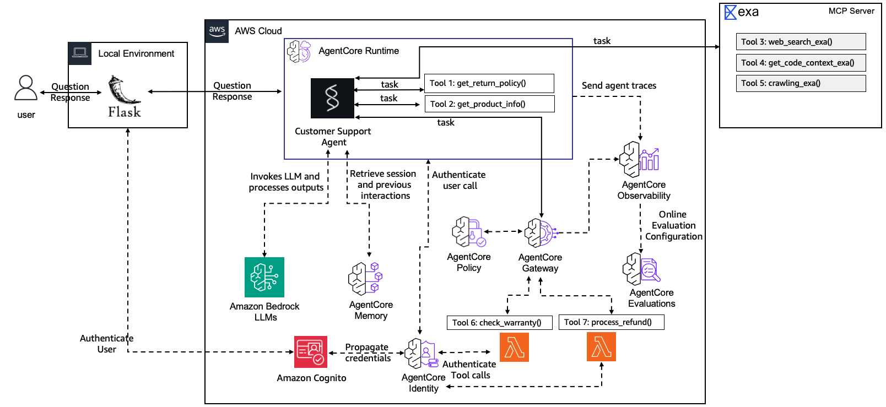

---

## Lab 8: Zero-Code Agents with Harness

**⏱️ Estimated time: ~25 minutes**

Create a declarative agent using AgentCore Harness — no framework code required. The harness supports code interpreter, gateway tools, and human-in-the-loop inline functions.

### Step 1: Add the Harness

```bash
agentcore add harness --name OrderResearchAgent
```

### Step 2: Add Code Interpreter

```bash
agentcore add harness-tool \
  --harness OrderResearchAgent \
  --type agentcore_code_interpreter \
  --name code-interpreter
```

### Step 3: Add OAuth Credential for Gateway Access

```bash
agentcore add credential \
  --name gateway-egress-oauth \
  --type OAuthCredentialProvider \
  --discovery-url "https://cognito-idp.<region>.amazonaws.com/<pool-id>/.well-known/openid-configuration" \
  --scopes "<scope>" \
  --vendor CustomOauth2

agentcore deploy -y -v
```

### Step 4: Add Gateway Tool

```bash
agentcore add harness-tool \
  --harness OrderResearchAgent \
  --type agentcore_gateway \
  --name my-gateway-secure \
  --gateway-arn <gateway-arn> \
  --outbound-auth-type oauth \
  --outbound-auth-provider-arn <provider-arn> \
  --outbound-auth-scopes "<scope>" \
  --outbound-auth-grant-type CLIENT_CREDENTIALS
```

### Step 5: Add Inline Function for HITL

```bash
agentcore add harness-tool \
  --harness OrderResearchAgent \
  --type inline_function \
  --name approve_exception
```

This creates a tool that pauses the agent and returns control to the caller for human approval.

The resulting `app/OrderResearchAgent/harness.json`:

```json
{
  "name": "OrderResearchAgent",
  "model": {
    "provider": "bedrock",
    "modelId": "us.anthropic.claude-sonnet-4-6"
  },
  "systemPrompt": "You are an order research specialist. Help customers investigate order issues, check warranties, and produce detailed analysis reports. Always be thorough and provide structured summaries. Save reports to /tmp/ when asked.",
  "tools": [
    {
      "type": "agentcore_code_interpreter",
      "name": "code-interpreter"
    },
    {
      "type": "agentcore_gateway",
      "name": "my-gateway-secure",
      "config": {
        "agentCoreGateway": {
          "gatewayArn": "<gateway-arn>",
          "outboundAuth": {
            "oauth": {
              "providerArn": "<provider-arn>",
              "scopes": ["<scope>"],
              "grantType": "CLIENT_CREDENTIALS"
            }
          }
        }
      }
    },
    {
      "type": "inline_function",
      "name": "approve_exception",
      "config": {
        "inlineFunction": {
          "description": "Request manager approval for a refund that exceeds the automated limit.",
          "inputSchema": {
            "type": "object",
            "properties": {
              "order_id": { "type": "string" },
              "amount": { "type": "number" },
              "reason": { "type": "string" }
            },
            "required": ["order_id", "amount", "reason"]
          }
        }
      }
    }
  ],
  "skills": [],
  "memory": { "mode": "disabled" }
}
```

### Step 6: Deploy and Test

```bash
agentcore deploy -y -v

# Test the harness
agentcore invoke --harness OrderResearchAgent "Check warranty status for PROD-002"
```

### Step 7: Test Human-in-the-Loop

Create `app/OrderResearchAgent/test_hitl.py` for the pause/resume HITL flow:

```python
"""
Human-in-the-Loop test for AgentCore Harness inline functions.

Usage:
    export HARNESS_ARN=<arn>
    python3 test_hitl.py
"""

import boto3
import json
import uuid
import os
import argparse

DEFAULT_PROMPT = (
    "A customer needs a $200 refund for order ORD-55555 because they received "
    "a damaged product. Try to process it, and if you can't, escalate for manager approval."
)

def parse_args():
    parser = argparse.ArgumentParser(description="Test HITL inline functions with AgentCore Harness")
    parser.add_argument("--harness-arn", default=os.environ.get("HARNESS_ARN"),
                        help="Harness ARN (default: HARNESS_ARN env var)")
    parser.add_argument("--prompt", default=DEFAULT_PROMPT, help="Prompt to send to the agent")
    return parser.parse_args()

def parse_stream(response):
    """Parse streaming response. Returns tool call info and stop reason."""
    tool_use_id = None
    tool_name = None
    tool_input_chunks = ""
    stop_reason = None
    current_block_is_tool = False

    for event in response["stream"]:
        if "contentBlockStart" in event:
            start = event["contentBlockStart"].get("start", {})
            if "toolUse" in start:
                tool_use_id = start["toolUse"]["toolUseId"]
                tool_name = start["toolUse"].get("name")
                tool_input_chunks = ""
                current_block_is_tool = True
            else:
                current_block_is_tool = False
        elif "contentBlockDelta" in event:
            delta = event["contentBlockDelta"].get("delta", {})
            if "text" in delta:
                print(delta["text"], end="", flush=True)
            elif "toolUse" in delta and current_block_is_tool:
                tool_input_chunks += delta["toolUse"].get("input", "")
        elif "contentBlockStop" in event:
            current_block_is_tool = False
        elif "messageStop" in event:
            stop_reason = event["messageStop"].get("stopReason")

    print()

    tool_input = None
    if tool_input_chunks:
        try:
            tool_input = json.loads(tool_input_chunks)
        except json.JSONDecodeError:
            decoder = json.JSONDecoder()
            try:
                tool_input, _ = decoder.raw_decode(tool_input_chunks)
            except json.JSONDecodeError:
                tool_input = {}

    return {
        "tool_use_id": tool_use_id,
        "tool_name": tool_name,
        "tool_input": tool_input,
        "stop_reason": stop_reason,
    }

def main():
    args = parse_args()
    harness_arn = args.harness_arn
    if not harness_arn:
        print("Error: HARNESS_ARN not set. Export it or pass --harness-arn.")
        exit(1)

    region = os.environ.get("AWS_REGION", os.environ.get("AWS_DEFAULT_REGION", "us-west-2"))
    client = boto3.client("bedrock-agentcore", region_name=region)
    session_id = str(uuid.uuid4())

    # Step 1: Send the prompt
    response = client.invoke_harness(
        harnessArn=harness_arn,
        runtimeSessionId=session_id,
        messages=[{"role": "user", "content": [{"text": args.prompt}]}],
    )
    result = parse_stream(response)

    # Step 2: If the agent paused on an inline function, prompt for approval
    if result["stop_reason"] == "tool_use" and result["tool_name"] == "approve_exception":
        print(f"\nAgent called: {result['tool_name']}")
        print(f"Input: {json.dumps(result['tool_input'], indent=2)}")
        approval = input("\nApprove this refund? (yes/no): ").strip().lower()

        if approval in ("yes", "y"):
            tool_result = json.dumps({"approved": True, "approver": "manager-jane"})
        else:
            tool_result = json.dumps({"approved": False, "reason": "Manager denied"})

        # Step 3: Resume with toolUse + toolResult
        tool_input_value = result["tool_input"] if isinstance(result["tool_input"], dict) else {}
        response = client.invoke_harness(
            harnessArn=harness_arn,
            runtimeSessionId=session_id,
            messages=[
                {"role": "assistant", "content": [
                    {"toolUse": {"toolUseId": result["tool_use_id"], "name": result["tool_name"], "input": tool_input_value}}
                ]},
                {"role": "user", "content": [
                    {"toolResult": {"toolUseId": result["tool_use_id"], "content": [{"text": tool_result}], "status": "success"}}
                ]},
            ],
        )
        parse_stream(response)
    else:
        print(f"\nAgent completed. Stop reason: {result['stop_reason']}")

if __name__ == "__main__":
    main()
```

Run the test:

```bash
HARNESS_ARN=$(cat /tmp/harness_arn.txt)
python3 app/OrderResearchAgent/test_hitl.py --harness-arn $HARNESS_ARN
```

Architecture with Harness agent:

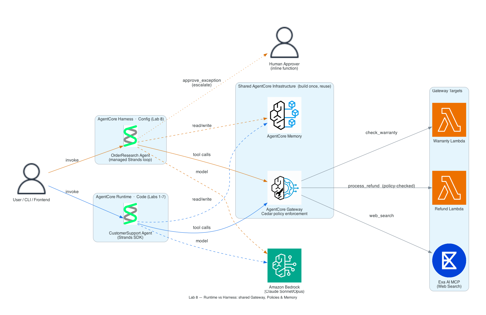

---

## Lab 9: Optimizing Agent Quality

**⏱️ Estimated time: ~30 minutes**

Use AI-generated recommendations from production traces to optimize the system prompt, then A/B test the optimized version against the original.

### Step 1: Generate Recommendations

```bash
# Run a recommendation job on your agent's traces
agentcore run recommendation \
  --agent CustomerSupport \
  --type system-prompt \
  --name cs-prompt-rec

# View the recommendation
agentcore view recommendation --name cs-prompt-rec
```

### Step 2: Create Config Bundles

Config bundles are versioned, immutable configuration snapshots:

```bash
# Control bundle (original prompt)
agentcore add config-bundle \
  --name customerSupportControl \
  --runtime CustomerSupportAB \
  --commit-message "Baseline prompt"

# Treatment bundle (optimized prompt from recommendation)
agentcore add config-bundle \
  --name customerSupportTreatment \
  --runtime CustomerSupportAB \
  --commit-message "Recommended prompt from cs-prompt-rec"
```

### Step 3: Create Dedicated A/B Runtime

Create `app/CustomerSupportAB/main.py` — a dedicated runtime that reads the active config bundle's system prompt:

```python
"""Customer support agent — dedicated A/B variant (config-bundle aware, IAM auth)."""
from strands import Agent, tool
from strands.models.bedrock import BedrockModel
from strands.hooks.events import BeforeModelCallEvent
from bedrock_agentcore.runtime import BedrockAgentCoreApp, BedrockAgentCoreContext

app = BedrockAgentCoreApp()
log = app.logger

MODEL_ID = "global.anthropic.claude-sonnet-4-6"
DEFAULT_SYSTEM_PROMPT = "You are a helpful and professional customer support assistant for an e-commerce company. Always use tools to get accurate information rather than guessing."

RETURN_POLICIES = {
    "electronics": {"window": "30 days", "condition": "Original packaging required, must be unused or defective", "refund": "Full refund to original payment method"},
    "accessories": {"window": "14 days", "condition": "Must be in original packaging, unused", "refund": "Store credit or exchange"},
    "audio": {"window": "30 days", "condition": "Defective items only after 15 days", "refund": "Full refund within 15 days, replacement after"},
}

PRODUCTS = {
    "PROD-001": {"name": "Wireless Headphones", "price": 79.99, "category": "audio", "description": "Noise-cancelling Bluetooth headphones with 30h battery life"},
    "PROD-002": {"name": "Smart Watch", "price": 249.99, "category": "electronics", "description": "Fitness tracker with heart rate monitor, GPS, and 5-day battery"},
    "PROD-003": {"name": "Laptop Stand", "price": 39.99, "category": "accessories", "description": "Adjustable aluminum laptop stand for ergonomic desk setup"},
    "PROD-004": {"name": "USB-C Hub", "price": 54.99, "category": "accessories", "description": "7-in-1 USB-C hub with HDMI, USB-A, SD card reader, and ethernet"},
    "PROD-005": {"name": "Mechanical Keyboard", "price": 129.99, "category": "electronics", "description": "RGB mechanical keyboard with Cherry MX switches"},
}

@tool
def get_return_policy(product_category: str) -> str:
    """Get return policy information for a specific product category (electronics, accessories, audio)."""
    policy = RETURN_POLICIES.get(product_category.lower())
    if policy:
        return f"Return policy for {product_category.lower()}: Window: {policy['window']}, Condition: {policy['condition']}, Refund: {policy['refund']}"
    return f"No specific return policy found for '{product_category}'. Please contact support."

@tool
def get_product_info(query: str) -> str:
    """Search for product information by name, ID (e.g. PROD-001), or keyword."""
    if query.upper() in PRODUCTS:
        p = PRODUCTS[query.upper()]
        return f"{p['name']} ({query.upper()}): ${p['price']}, Category: {p['category']}, {p['description']}"
    q = query.lower()
    results = [f"{pid}: {p['name']} - ${p['price']} - {p['description']}" for pid, p in PRODUCTS.items()
               if q in p['name'].lower() or q in p['description'].lower() or q in p['category'].lower()]
    return "Found products:\n" + "\n".join(results) if results else f"No products found matching '{query}'."

agent = Agent(
    model=BedrockModel(model_id=MODEL_ID),
    system_prompt=DEFAULT_SYSTEM_PROMPT,
    tools=[get_return_policy, get_product_info],
)

def dynamic_config_hook(event: BeforeModelCallEvent):
    """Apply the system prompt from the active config bundle before each model call."""
    try:
        config = BedrockAgentCoreContext.get_config_bundle()
    except Exception as e:
        log.warning(f"Could not read config bundle, using default prompt: {e}")
        config = {}
    event.agent.system_prompt = config.get("system_prompt", DEFAULT_SYSTEM_PROMPT)

agent.hooks.add_callback(BeforeModelCallEvent, dynamic_config_hook)


@app.entrypoint
def invoke(payload, context):
    result = agent(payload.get("prompt", "Hello"))
    return {"response": result.message["content"][0]["text"]}


if __name__ == "__main__":
    app.run()
```

Add the runtime to `agentcore.json`:

```json
{
  "name": "CustomerSupportAB",
  "build": "CodeZip",
  "entrypoint": "main.py",
  "codeLocation": "app/CustomerSupportAB/",
  "runtimeVersion": "PYTHON_3_14",
  "networkMode": "PUBLIC",
  "protocol": "HTTP"
}
```

### Step 4: Add A/B Gateway Target

```bash
agentcore add gateway-target \
  --gateway my-gateway-secure \
  --name customer-support-ab \
  --type httpRuntime \
  --runtime CustomerSupportAB
```

### Step 5: Add Online Evaluation for A/B

```bash
agentcore add online-eval \
  --name ABQualityMonitor \
  --agent CustomerSupportAB \
  --evaluator Builtin.GoalSuccessRate \
  --sampling-rate 100
```

### Step 6: Deploy and Run A/B Test

```bash
agentcore deploy -y -v

agentcore run ab-test \
  --name promptAbTest \
  --control customerSupportControl \
  --treatment customerSupportTreatment \
  --evaluator ABQualityMonitor \
  --traffic-split 50
```

### Step 7: Send Test Traffic and View Results

```bash
# Send traffic that will be split between control and treatment
for i in $(seq 1 10); do
  agentcore invoke "What products do you have?" --gateway my-gateway-secure --target customer-support-ab -H "Authorization: Bearer $TOKEN"
done

# View A/B test status
agentcore view ab-test --name promptAbTest

# Stop the test when done
agentcore stop ab-test --name promptAbTest
```

---

## Lab 10: Web Search with AgentCore Gateway

**⏱️ Estimated time: ~30 minutes**

> **Important:** The AWS-managed Web Search Tool connector is only available in **us-east-1**. If you're running in us-west-2, skip this lab.

Replace the Exa AI MCP client with the AWS-managed Web Search connector on the AgentCore Gateway.

### Step 1: Add Web Search Connector

```bash
agentcore add gateway-target \
  --gateway my-gateway-secure \
  --name WebSearch \
  --type connector \
  --connector-type web-search
```

### Step 2: Deploy

```bash
agentcore deploy -y -v
```

### Step 3: Test Web Search

```bash
agentcore invoke "Search the web for the latest Amazon Bedrock AgentCore features" \
  -H "Authorization: Bearer $TOKEN" \
  --session-id $(uuidgen)
```

The web search connector provides date-aware search capabilities and is fully managed by AWS — no API keys or external service accounts required.

Final architecture with Web Search:

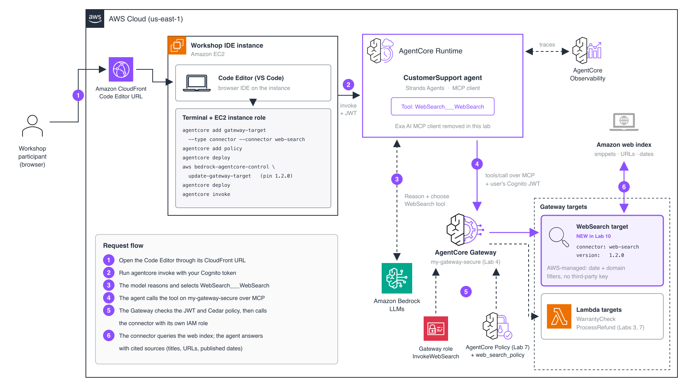

### Summary

After completing all 10 labs, you have deployed a production-ready AI agent system with:

- **Serverless runtime** on AgentCore Runtime (auto-scaling, zero infrastructure management)
- **Persistent memory** via AgentCore Memory (semantic + summarization strategies)
- **Centralized tool routing** through AgentCore Gateway (Lambda targets, web search, agent-to-agent)
- **JWT authentication** via Amazon Cognito
- **Fine-grained governance** with Cedar policies on the Gateway
- **Real-time observability** through CloudWatch traces and logs
- **Continuous evaluation** with built-in quality metrics
- **AI-powered optimization** through recommendation jobs and A/B testing
- **Zero-code agent capabilities** via AgentCore Harness with HITL support
- **Web-based frontend** for customer interaction

---

> **Cleanup:** If running self-paced, follow the workshop cleanup steps to avoid ongoing AWS charges. Delete the CloudFormation stacks and AgentCore resources when done.
